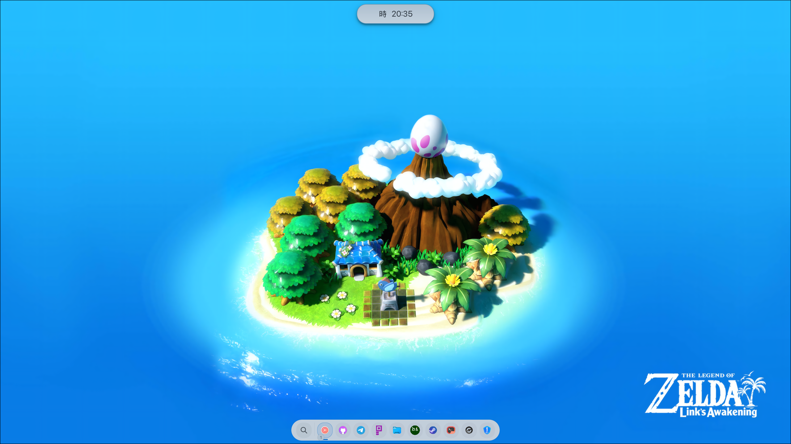

# Ukishima

\<p align="center">
&#x20; \<strong>A personal desktop shell built with Quickshell, QML and Hyprland.\</strong>
&#x20; \<br>
&#x20; A modular Wayland interface for navigation, applications, media and system controls.
\</p>

\<p align="center">
&#x20; \<a href="#features">Features\</a> ·
&#x20; \<a href="#screenshots">Screenshots\</a> ·
&#x20; \<a href="#installation">Installation\</a> ·
&#x20; \<a href="#documentation">Documentation\</a> ·
&#x20; \<a href="[https://github.com/amanhex/Ukishima](https://github.com/amanhex/Ukishima)">Original project\</a>
\</p>

\<p align="center">
&#x20; \
\</p>

---

Ukishima is a desktop shell built with **Quickshell and Qt Quick**, designed around a compact pill interface and a collection of integrated surfaces.

This repository is a personal fork of [amanhex/Ukishima](https://github.com/amanhex/Ukishima). It preserves the original project's visual direction while adding new interfaces, Hyprland integrations, application management and desktop workflows.

The goal is to keep the desktop visually coherent: controls, applications, media and system information are brought together in one configurable environment.

## Features

| Area                         | Features                                                                                                |
| ---------------------------- | ------------------------------------------------------------------------------------------------------- |
| **Pill and navigation**      | Per-monitor interface, expandable surfaces, configurable shortcuts and right-click navigation           |
| **Application Dock**         | Pinned applications, running windows, workspace-aware grouping, edge reveal and multiple positions      |
| **Appearance**               | Light, Dark, Dynamic and Manual palettes, OLED mode, custom accents, transparency, fonts and animations |
| **Media**                    | MPRIS playback controls, album artwork, multiple-player selection and alternative visual styles         |
| **Beats**                    | Separate interface for local music and configured online stations                                       |
| **System tools**             | Launcher, Calendar, Timer, Clipboard, Scratchpad, Weather, Wi-Fi, Bluetooth, Battery and System Monitor |
| **Recording**                | GPU Screen Recorder integration, screen/window/region capture, audio controls and replay                |
| **Wallpaper**                | Local wallpaper workflow, dynamic palette synchronization and optional Waywallen integration            |
| **Application installation** | Launcher drop installer for AppImages, packages, archives, fonts and wallpapers                         |

The shell is designed to react to the current monitor, workspace and window state. Individual surfaces share the same theme and animation system.

## Screenshots

| Shell and navigation | Application Dock |
| -------------------- | ---------------- |
|                      |                  |

| Top bar |   | Media and Beats |   |
| ------- | - | --------------- | - |
|         |   |                 |   |

| Audio controls | System Monitor |
| -------------- | -------------- |
|                |                |

| Screen recording | Beats |
| ---------------- | ----- |
|                  |       |

## Highlights

### A configurable shell

The pill is the main entry point to Ukishima's surfaces. It adapts to the active monitor and Hyprland state, and provides configurable shortcuts and navigation.

The appearance settings include:

- Light, Dark, Dynamic and Manual palettes.
- OLED mode and custom accent colors.
- Glass effects and transparency.
- Interface scaling and font selection.
- Animation styles and reduced motion.
- Auto-hide and Memory Saver options.
- Configurable modules and right-click navigation.

### A native application Dock

The Dock is implemented as a Quickshell surface rather than a separate desktop application.

It supports pinned applications, automatically detected running windows, application grouping, multiple positions, adjustable size, edge reveal and fullscreen-aware visibility.

See [Application Dock](docs/DOCK.md).

### Media and Beats

The Media surface controls compatible MPRIS players. It can show track information and artwork, expose playback controls and switch between active players.

Beats is a separate interface for local music and configured online stations.

**Beats requires an external helper script** at `~/.config/hypr/UserScripts/UkishimaBeats.sh`. That helper is not included in this repository.

See [Media and Beats](docs/MEDIA-BEATS.md).

### Desktop tools

Ukishima brings together several everyday tools:

- **Launcher:** application search, usage-based ranking and calculator.
- **Calendar:** local events, recurring entries and reminders.
- **Timer:** presets and custom countdowns.
- **Clipboard:** clipboard history with image previews.
- **Scratchpad:** persistent notes with autosave and pinning.
- **Weather:** Open-Meteo forecasts and editable location.
- **System surfaces:** network, Bluetooth, battery, notifications and system monitoring.

See [Feature guide](docs/FEATURES.md) and [System surfaces](docs/SYSTEM-SURFACES.md).

### Screen recording and audio

The Recorder surface integrates GPU Screen Recorder for monitor, window and region capture, with configurable quality, frame rate, cursor and audio inputs.

The replay action saves the most recent 30 seconds through `gsr-cli`. It depends on an already running GPU Screen Recorder instance with its replay buffer available.

The Mixer exposes PipeWire output and input controls, including per-application audio streams.

See [Recording and audio](docs/RECORDING-AUDIO.md).

### Wallpapers and Waywallen

Ukishima retains its local wallpaper workflow and can optionally integrate [Waywallen](https://github.com/waywallen/waywallen).

The integration adds a wallpaper catalog bridge, a Hyprland layer-shell client, animated wallpaper settings and dynamic palette synchronization.

Waywallen is a separate Flatpak application and must be installed independently.

See [Waywallen integration](docs/WAYWALLEN.md).

### Application installer

The launcher can handle dropped files through `scripts/app-install.sh`.

Supported categories include:

- AppImage applications.
- Native package formats supported by the available package manager.
- Flatpak reference files.
- Compressed archives and ZIP files.
- TTF and OTF fonts.
- Wallpaper images.

AppImage metadata inspection executes the supplied file with `--appimage-extract`. Only use AppImages from sources you trust.

## Installation

### Requirements

The shell is built for:

- Linux
- Wayland
- Hyprland
- Quickshell
- Qt Quick

Additional utilities are used by individual integrations. The installation script checks for tools such as `jq`, `curl`, `python3`, ImageMagick, FFmpeg, NetworkManager, BlueZ, PipeWire-related components and Wayland utilities.

Some optional features also use GPU Screen Recorder, `mpvpaper`, `matugen`, `ddcutil`, `kdialog` or `zenity`.

### Clone and launch

```bash
git clone --branch mie-modifiche https://github.com/Mhurino/ukishima.git
cd ukishima
./launch.sh
```

The launcher uses `qs` when available, otherwise it falls back to `quickshell`.

### Installation script

The repository also includes `install.sh`. It copies the project into:

```text
~/.local/share/quickshell/ukishima
```

The destination can be changed through `UKISHIMA_INSTALL_ROOT`.

**Important:** when `rsync` is available, the installer uses `rsync --delete`. Check the destination before running it: files in the destination that are not present in the source can be removed.

The script prints the dependencies it cannot find and the launch command for the installed copy.

## Documentation

| Guide                                          | Contents                                                                       |
| ---------------------------------------------- | ------------------------------------------------------------------------------ |
| [Feature guide](docs/FEATURES.md)              | Pill, navigation, Timer, Clipboard, Scratchpad, Weather and appearance         |
| [Application Dock](docs/DOCK.md)               | Layout, positions, pinned apps, running windows and interactions               |
| [Media and Beats](docs/MEDIA-BEATS.md)         | MPRIS, playback, local music and online stations                               |
| [Recording and audio](docs/RECORDING-AUDIO.md) | Recorder, replay, capture settings and PipeWire Mixer                          |
| [System surfaces](docs/SYSTEM-SURFACES.md)     | Launcher, Calendar, Inbox, networking, battery and system tools                |
| [Waywallen integration](docs/WAYWALLEN.md)     | Setup, services, wallpaper rendering, NVIDIA compatibility and troubleshooting |

## Project status

This is an independently maintained personal fork. Its additional features and implementation can evolve separately from the original project.

The repository is intended for customization, experimentation and continued development. It is not the official Ukishima distribution.

## Credits

The original Ukishima project and its authors:

[**amanhex/Ukishima**](https://github.com/amanhex/Ukishima)

The original authors and contributors retain credit for their upstream work. Additional features and modifications in this repository are maintained independently.
