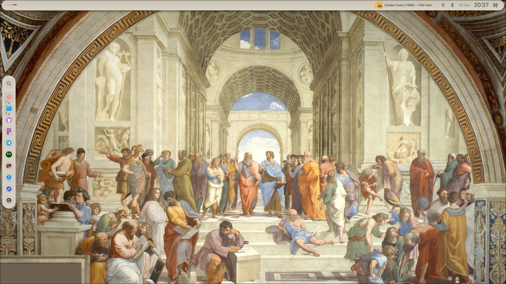
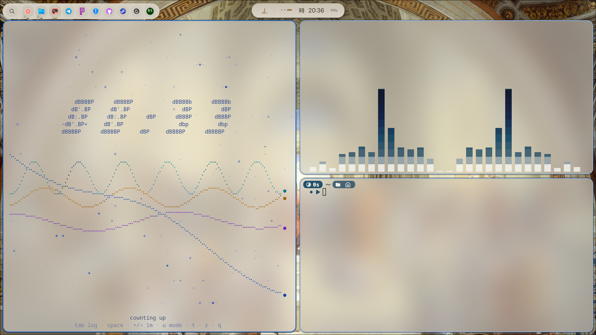
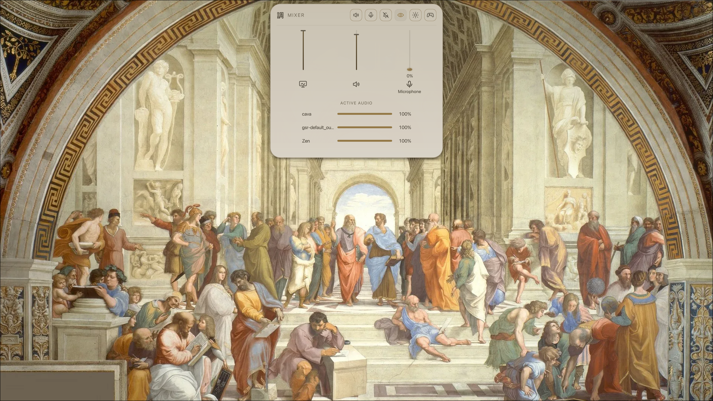
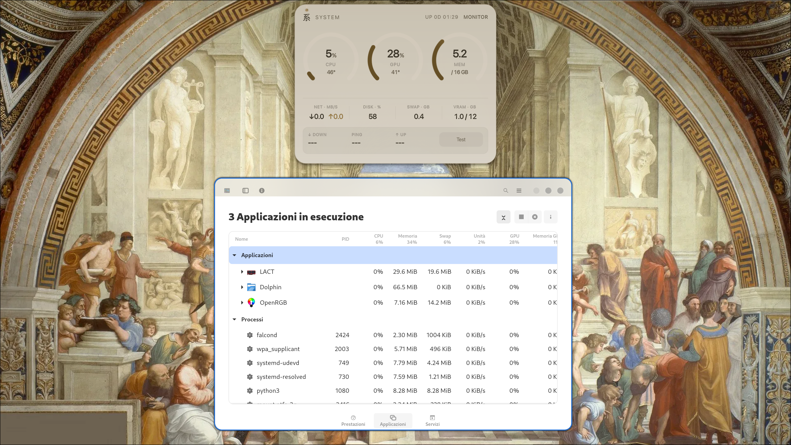
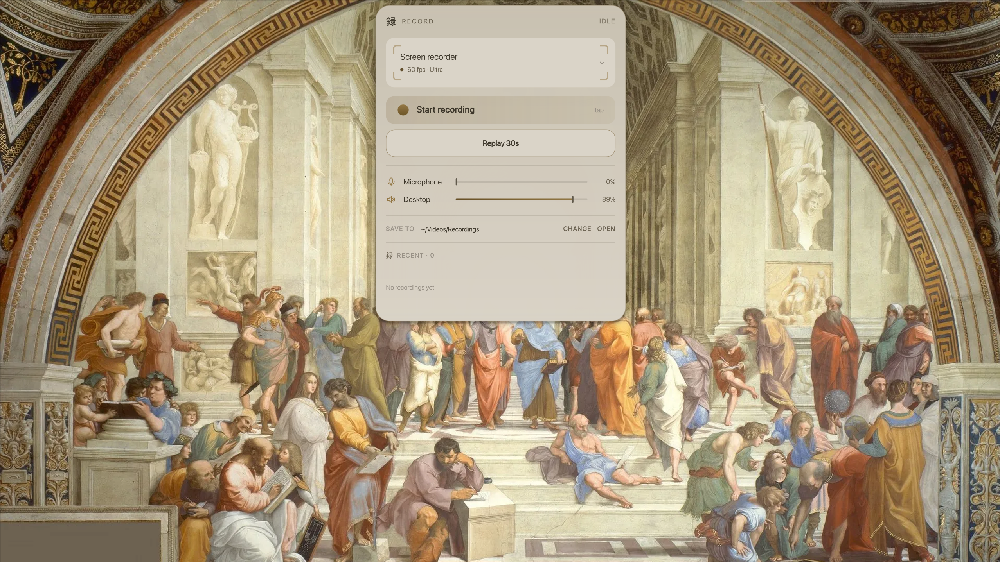
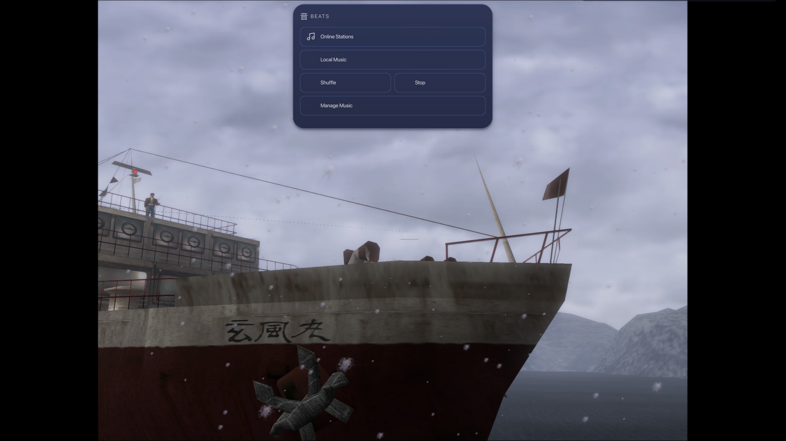
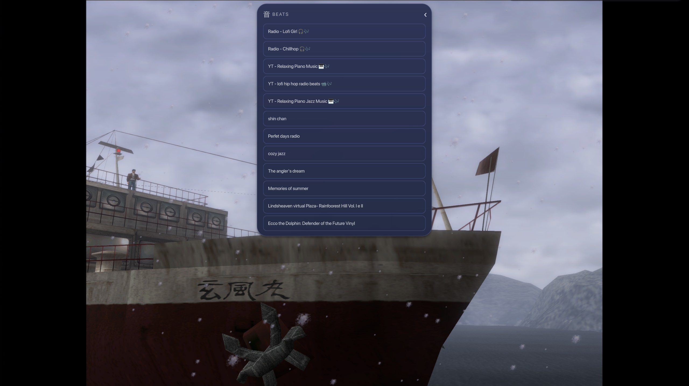

# Ukishima

**A personal desktop shell built with Quickshell, QML and Hyprland.**

A modular Wayland interface bringing navigation, applications, media and system controls together in one coherent desktop experience.


[Features](#features) · [Screenshots](#screenshots) · [Installation](#installation) · [Documentation](#documentation) · [Original project](https://github.com/amanhex/Ukishima)

---

Ukishima is a desktop shell built with **Quickshell and Qt Quick**, designed around a compact pill interface and a collection of integrated surfaces.

This repository is a personal fork of [amanhex/Ukishima](https://github.com/amanhex/Ukishima). It preserves the original project's visual direction while adding new interfaces, Hyprland integrations, application management and desktop workflows.

## Features

| Area | Features |
|---|---|
| **Pill and navigation** | Per-monitor interface, expandable surfaces, configurable shortcuts and right-click navigation |
| **Application Dock** | Pinned applications, running windows, workspace-aware grouping, edge reveal and multiple positions |
| **Appearance** | Light, Dark, Dynamic and Manual palettes, OLED mode, custom accents, transparency, fonts and animations |
| **Media** | MPRIS playback controls, album artwork, multiple-player selection and alternative visual styles |
| **Beats** | Separate interface for local music and configured online stations |
| **System tools** | Launcher, Calendar, Timer, Clipboard, Scratchpad, Weather, Wi-Fi, Bluetooth, Battery and System Monitor |
| **Recording** | GPU Screen Recorder integration, screen/window/region capture, audio controls and replay |
| **Wallpaper** | Local wallpaper workflow, dynamic palette synchronization and optional Waywallen integration |
| **Application installer** | Launcher drop installer for AppImages, packages, archives, fonts and wallpapers |

The shell reacts to the current monitor, workspace and window state. Individual surfaces share the same theme and animation system.

## Screenshots

### Shell and navigation


### Top bar



### Application Dock



### Audio controls



### System Monitor



### Screen recording



### Beats





## Highlights

### A configurable shell

The pill is the main entry point to Ukishima's surfaces. It adapts to the active monitor and Hyprland state, and provides configurable shortcuts and navigation.

Appearance settings include:

- Light, Dark, Dynamic and Manual palettes.
- OLED mode and custom accent colors.
- Glass effects and transparency.
- Interface scaling and font selection.
- Animation styles and reduced motion.
- Auto-hide and Memory Saver options.
- Configurable modules and right-click navigation.

### A native application Dock

The Dock is implemented as a Quickshell surface rather than a separate desktop application.

It supports pinned applications, automatically detected running windows, application grouping, multiple positions, adjustable size, edge reveal and fullscreen-aware visibility.

See [Application Dock](docs/DOCK.md).

### Media and Beats

The Media surface controls compatible MPRIS players. It can show track information and artwork, expose playback controls and switch between active players.

Beats is a separate interface for local music and configured online stations.

**Beats requires an external helper script** at `~/.config/hypr/UserScripts/UkishimaBeats.sh`. That helper is not included in this repository.

See [Media and Beats](docs/MEDIA-BEATS.md).

### Desktop tools

Ukishima brings together several everyday tools:

- **Launcher:** application search, usage-based ranking and calculator.
- **Calendar:** local events, recurring entries and reminders.
- **Timer:** presets and custom countdowns.
- **Clipboard:** clipboard history with image previews.
- **Scratchpad:** persistent notes with autosave and pinning.
- **Weather:** Open-Meteo forecasts and editable location.
- **System surfaces:** network, Bluetooth, battery, notifications and system monitoring.

See [Feature guide](docs/FEATURES.md) and [System surfaces](docs/SYSTEM-SURFACES.md).

### Screen recording and audio

The Recorder surface integrates GPU Screen Recorder for monitor, window and region capture, with configurable quality, frame rate, cursor and audio inputs.

The replay action saves the most recent 30 seconds through `gsr-cli`. It depends on an already running GPU Screen Recorder instance with its replay buffer available.

The Mixer exposes PipeWire output and input controls, including per-application audio streams.

See [Recording and audio](docs/RECORDING-AUDIO.md).

### Wallpapers and Waywallen

Ukishima retains its local wallpaper workflow and can optionally integrate [Waywallen](https://github.com/waywallen/waywallen).

The integration adds a wallpaper catalog bridge, a Hyprland layer-shell client, animated wallpaper settings and dynamic palette synchronization.

Waywallen is a separate Flatpak application and must be installed independently.

See [Waywallen integration](docs/WAYWALLEN.md).

### Application installer

The launcher can handle dropped files through `scripts/app-install.sh`.

Supported categories include:

- AppImage applications.
- Native package formats supported by the available package manager.
- Flatpak reference files.
- Compressed archives and ZIP files.
- TTF and OTF fonts.
- Wallpaper images.

AppImage metadata inspection executes the supplied file with `--appimage-extract`. Only use AppImages from sources you trust.

## Installation

Ukishima can be launched directly from a cloned repository or copied into a dedicated user installation directory.

### Requirements

The shell is designed for:

- Linux
- Wayland
- Hyprland
- Quickshell
- Qt Quick

The installation script checks for a number of command-line dependencies, including:

- `jq`, `curl` and `python3`
- ImageMagick (`magick`)
- `awww` and `awww-daemon`
- `ffmpeg`
- NetworkManager (`nmcli`)
- BlueZ (`bluetoothctl`)
- `cava` and `cliphist`
- `wl-paste` and `slurp`
- `hyprsunset`
- `notify-send` and `xdg-open`

Optional tools include GPU Screen Recorder, `mpvpaper`, `matugen`, `ddcutil`, `kdialog` and `zenity`.

Requirements depend on which features are used. The installation script checks for missing commands and reports them; **it does not install system packages automatically**.

### Option 1: Clone and launch

Clone the personal fork and enter the directory:

```bash
git clone --branch mie-modifiche https://github.com/Mhurino/ukishima.git
cd ukishima
```

Launch the shell:

```bash
./launch.sh
```

The launcher uses `qs -p` when `qs` is available. Otherwise, it falls back to `quickshell --path`.

Both commands launch the configuration directly from the repository directory. See the [Quickshell command-line documentation](https://quickshell.org/docs/v0.3.2/guide/introduction/) for details about path-based configuration loading.

### Option 2: Install into the user directory

From the cloned repository, run:

```bash
./install.sh
```

By default, the script copies the project into:

```text
~/.local/share/quickshell/ukishima
```

A custom destination can be selected with `UKISHIMA_INSTALL_ROOT`:

```bash
UKISHIMA_INSTALL_ROOT="$HOME/Applications/ukishima" ./install.sh
```

The installer:

1. Copies the configuration, scripts, components and optional Hyprland modules.
2. Checks for required and optional dependencies.
3. Reports missing commands.
4. Prints the command to launch the installed configuration.

The launch command uses `qs --path` or, when necessary, `quickshell --path`, depending on the available executable.

### Updating an existing installation

When the destination already contains files, the installer first creates a backup under:

```text
${XDG_STATE_HOME:-$HOME/.local/state}/ukishima/backups/
```

It then updates the files from the repository without deleting unrelated files already present in the destination.

Files with matching names are updated, so local edits to those files are replaced by the repository versions. The backup retains the previous installation and its customizations.

If the repository itself is already located in the installation directory, the installer skips the copy operation.

### Optional Hyprland module

The repository includes an optional Hyprland Lua module for the Ukishima layer blur rule.

The installer prints the corresponding `source` directive with the actual installation path. Add that line to your Hyprland configuration only when you want to enable the rule.

**The installer does not configure automatic startup in Hyprland.** Launching Ukishima at login remains a separate session configuration step.

## Documentation

| Guide | Contents |
|---|---|
| [Feature guide](docs/FEATURES.md) | Pill, navigation, Timer, Clipboard, Scratchpad, Weather and appearance |
| [Application Dock](docs/DOCK.md) | Layout, positions, pinned apps, running windows and interactions |
| [Media and Beats](docs/MEDIA-BEATS.md) | MPRIS, playback, local music and online stations |
| [Recording and audio](docs/RECORDING-AUDIO.md) | Recorder, replay, capture settings and PipeWire Mixer |
| [System surfaces](docs/SYSTEM-SURFACES.md) | Launcher, Calendar, Inbox, networking, battery and system tools |
| [Waywallen integration](docs/WAYWALLEN.md) | Setup, services, wallpaper rendering, NVIDIA compatibility and troubleshooting |

## Project status

This is an independently maintained personal fork. Its additional features and implementation can evolve separately from the original project.

The repository is intended for customization, experimentation and continued development. It is not the official Ukishima distribution.

## Credits

The original Ukishima project and its authors:

**[amanhex/Ukishima](https://github.com/amanhex/Ukishima)**

The original authors and contributors retain credit for their upstream work. Additional features and modifications in this repository are maintained independently.
